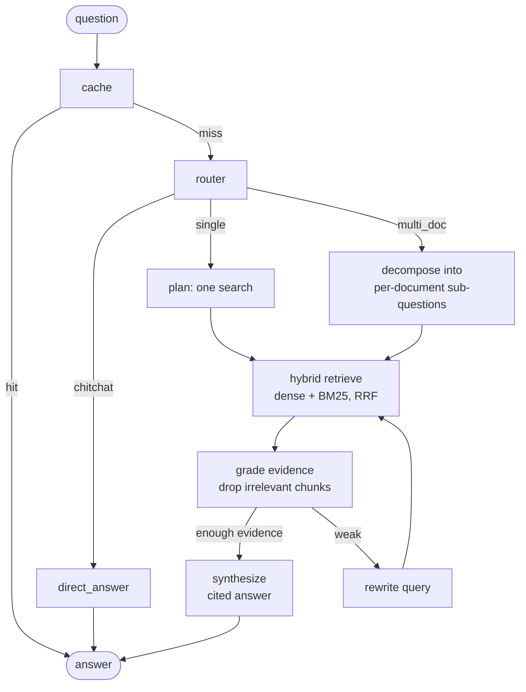

# DocuSense — Agentic RAG Platform

A multi-tenant B2B SaaS that turns unstructured business documents (PDFs, spreadsheets, logs) into a private knowledge base you can chat with. A **LangGraph** agent routes each question, splits comparisons into per-document sub-questions, grades its own retrieved evidence, and rewrites searches that come back empty. Every answer cites the exact file and page it came from.

It runs on open-source models: self-hosted Llama 3.1 via Ollama for private deployments, or any OpenAI-compatible API (such as Groq) for a public demo.

**Live demo:** _add your Vercel URL here_ · **Deploy your own for free:** [DEPLOY.md](DEPLOY.md) · **How it works, in depth:** [GUIDE.md](GUIDE.md)

## The agent



The compiled graph is also served live by the API at `GET /agent/graph` (Mermaid source).

| Behaviour | How it works | Where |
|---|---|---|
| **Agentic routing** | An LLM router classifies each question as chit-chat, single-search or multi-document; a conditional edge picks the path. Chit-chat skips retrieval entirely. | `router_node`, `after_router` |
| **Multi-document reasoning** | Comparison questions are decomposed into sub-questions, each scoped to one document. Sub-questions are retrieved and graded in parallel, then the synthesizer reasons across all of them. | `decompose_node`, `synthesize_node` |
| **Self-correction** | Each sub-question's retrieved chunks are graded in one batched LLM call; irrelevant ones are dropped. A sub-question left without evidence loops back through a query rewrite (bounded iterations). | `grade_node`, `after_grade`, `rewrite_node` |
| **Semantic cache** | Paraphrased repeat questions are answered from Redis without touching the LLM. | `cache_node` |

All of it lives in [`backend/app/services/agent.py`](backend/app/services/agent.py).

## Architecture

```
[Next.js UI] → (Nginx) → [FastAPI] → PostgreSQL   tenants, auth, chat history, per-query metrics
                            │      → Redis        Celery broker + semantic cache
                            │      → Qdrant       vectors, filtered by tenant inside the search
                            │      → LLM          Ollama (self-hosted) or OpenAI-compatible API
                            └─→ [Celery worker]   layout-aware ingestion (or inline on free hosting)
```

**Ingestion.** Uploads return `202 Accepted` immediately and are processed in the background. PDFs go through PyMuPDF table detection (tables become Markdown, so rows and columns survive) and font-size heading detection. Spreadsheets become Markdown row-groups with the header repeated on each. Chunking follows document structure: headings start new chunks and are prepended as context, and tables are never split.

**Multi-tenancy.** Every row carries `org_id`, every JWT carries the tenant claim, and the tenant filter is applied inside Qdrant on every search and delete, so one company's vectors can't be returned to another even if application code had a bug.

**Operations.** Every query logs latency, retrieval and LLM time, tokens/sec, the route taken, sub-question count, rewrites and cache hits. The admin dashboard aggregates them, including p95 latency and user feedback.

## Run it locally

You need Docker Desktop and [Ollama](https://ollama.com).

```bash
ollama pull llama3.1:8b          # or llama3.2:3b on a laptop with 8 GB RAM
cp .env.example .env             # defaults already point at Ollama on your machine
docker compose up --build
```

Open http://localhost, create a workspace, upload documents and ask questions. The API docs are at http://localhost/api/docs.

No GPU or a slow laptop? Set `LLM_PROVIDER=openai` and `LLM_API_KEY=<your Groq key>` in `.env` to use a hosted model instead.

## Deploy for free

Vercel (frontend) + Render (API) + Neon (Postgres) + Qdrant Cloud + Groq, all on free tiers. Step-by-step instructions, including pushing to GitHub: **[DEPLOY.md](DEPLOY.md)**.

## Key engineering decisions

| Decision | Why |
|---|---|
| LangGraph state machine instead of a hand-written loop | Routing, fan-out and the retry loop are explicit nodes and conditional edges; the graph is inspectable, testable per node and exportable as a diagram |
| LangGraph over CrewAI | This is a controlled workflow with loops, not a team of role-playing agents; LangGraph models exactly that |
| Batched grading (one call per sub-question) | Grades 8 chunks in one request instead of 8, which cuts latency and fits free-tier API rate limits |
| Per-document scoping on sub-questions | "Compare A and B" retrieves from A and from B separately, so one document can't crowd the other out of the top results |
| Rewrite widens the scope | A scoped search that found nothing may have been scoped to the wrong file, so the retry searches all documents |
| RRF fusion of dense and BM25 results | Rank-based fusion avoids mixing incompatible score scales (cosine vs BM25) |
| fastembed (ONNX) for embeddings | Same bge-small model without PyTorch: a few hundred MB of RAM instead of ~1.5 GB, so it fits free hosting |
| Pluggable LLM provider | One environment variable switches between private Ollama and a hosted API |
| Celery or inline ingestion | Celery for a scalable deployment; inline background tasks where the host has no worker processes |
| Deterministic Qdrant point IDs | Re-ingesting a document overwrites its vectors instead of duplicating them |

## Tests

`backend` was verified end-to-end (FastAPI app, real LangGraph, in-memory Qdrant, SQLite, with stubbed LLM and embeddings) for: inline ingestion of PDF, CSV and text files; chit-chat, single and multi-document routes; evidence from both documents in a comparison; the rewrite loop; tenant isolation; metrics; and deletion.

## Roadmap

- Streaming answers token by token (SSE)
- Cross-encoder reranker before grading
- Alembic migrations in place of `create_all`
- OCR for scanned PDFs
- Per-document access control inside a tenant

## Stack

LangGraph · FastAPI · Celery · Redis · PostgreSQL · Qdrant · fastembed (bge-small) · rank-bm25 · PyMuPDF · Ollama / Groq (Llama 3.1 8B) · Next.js 14 · TypeScript · Tailwind · Tremor · Nginx · Docker Compose
